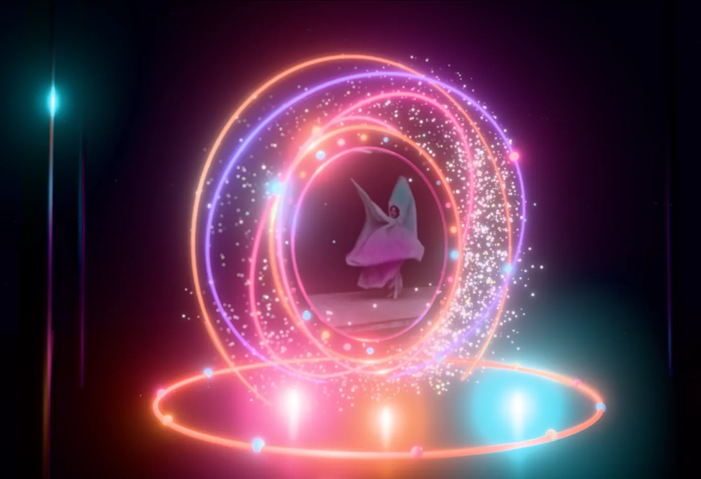
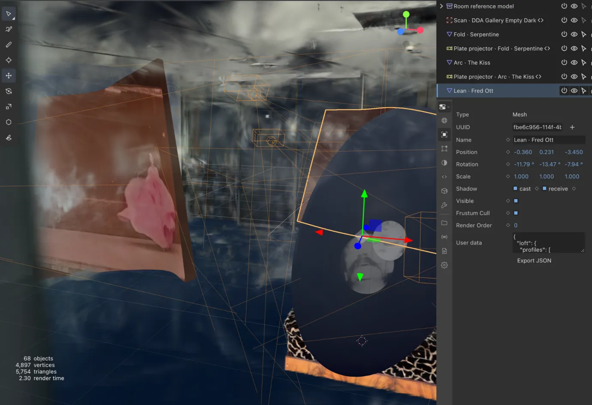

# threeditor

threeditor is a browser-based workspace for making interactive 3D scenes. Arrange objects, lights, and cameras visually, animate them with a timeline or JavaScript, then share your scene as a web page. It builds on the [three.js editor](https://github.com/mrdoob/three.js/tree/dev/editor).

**[Open threeditor](https://languel.github.io/threeditor/)** · **[Try the Fox woodland demo](https://languel.github.io/threeditor/demos/fox-follow/)**

*Serpentine particles, a scene you can open under **File → Examples → lessons**.*

## Make your first edit

1. Open the [Fox woodland demo](https://languel.github.io/threeditor/demos/fox-follow/). Drag to look around the fox and scroll to zoom.
2. Click **Edit scene** to open the same project in threeditor. Select an object in the viewport or the scene list on the right. Try moving it with the arrows on the object or changing its position in **Properties**.
3. Click **Play Scene** to see the scene run. Use **File → Save** to keep your own copy. When you’re ready to share it, **File → Publish → Playable HTML** exports a single file for playback.

For a smaller example, start with **A spinning cube** under **File → Examples → lessons**. The [lesson guide](editor/examples/lessons/README.md) explains what to look for and how to change each scene.

## Explore projection mapping

*DDA Gallery · Lofts and cinema fragments. Open it under **File → Examples → Captured spaces** to see how the projectors and surfaces are arranged.*

## Guides

- [Editor and modeling reference](docs/editor-reference.md) covers the interface, examples, assets, materials, and modeling tools.
- [Projection mapping](docs/projection-mapping.md) covers projectors, masks, alignment, and output. See also the [captured spaces examples](editor/examples/gallery/README.md).
- [Scripting, animation, devices, and publishing](docs/interactive-scenes.md) covers scripts, the timeline, inputs, and export formats.
- [Developer setup](docs/development.md) covers running locally and maintaining the editor.
